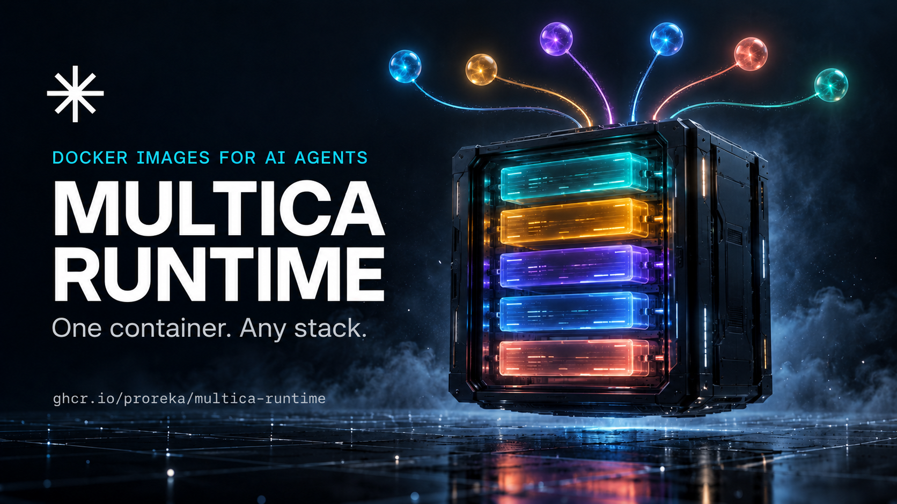

# Multica Runtime



**Docker images that turn Claude Code and OpenCode into Multica agents.**

One container, four environment variables, and you have an agent runtime that
picks up tasks, works in a real repository, and keeps its session history across
restarts.

```bash
cp .env.example .env      # MULTICA_TOKEN, AI_BASE_URL, AI_API_KEY, AI_MODEL
docker compose up -d
```

That is the whole setup. No CLI installation, no Node/PHP/Flutter toolchain on
your laptop, no per-agent configuration.

## Why this exists

Running a Multica agent normally means installing an agent CLI, keeping it up to
date, wiring it to a model endpoint, and repeating that on every machine. It gets
worse when different tasks need different toolchains: a Laravel task needs PHP
and three databases, a Flutter task needs the Android SDK, a QA task needs
Playwright and k6.

These images put each stack in a container that:

- ships **Claude Code and OpenCode**, both pointed at the same AI router;
- registers with Multica automatically and runs the daemon in the foreground;
- runs as a **non-root** user (uid 1000) on Debian 13;
- keeps sessions on a volume, so a restart does not lose context;
- is **built in CI** for `linux/amd64` and `linux/arm64`, with every tool pinned.

## What is included

| Image tag | What you get |
|---|---|
| `:base` | Node 26 LTS, Python 3, git/gh, Chromium, build tools, Claude Code, OpenCode, Multica CLI |
| `:node` | pnpm, yarn, TypeScript, Playwright, vitest, eslint, prettier |
| `:python` | uv, Poetry, ruff, mypy, pytest, C headers |
| `:php` | PHP 8.4, Composer, Laravel, MariaDB + PostgreSQL + Redis inside the container |
| `:go` | Go toolchain, golangci-lint |
| `:flutter` | Flutter, Android SDK, JDK 21, Gradle |
| `:devops` | Terraform, AWS CLI, kubectl, Helm, Docker CLI, Wrangler, yq |
| `:qa` | Playwright + MCP, axe-core, newman, k6, pytest |
| `:design` | ImageMagick, Playwright, Penpot MCP + plugin |

All tags come from one package: `ghcr.io/proreka/multica-runtime`.

## The configuration surface

Only these four are required:

```dotenv
MULTICA_TOKEN=...          # https://multica.ai/settings?tab=tokens
AI_BASE_URL=https://...    # any Anthropic-compatible endpoint
AI_API_KEY=...
AI_MODEL=...
```

Both agent CLIs are configured from those values. Native variables
(`ANTHROPIC_*`) still work and win when both are set.

→ [Full configuration reference](configuration.md)

## Documentation

- [Quickstart](quickstart.md) — from zero to a registered runtime
- [Configuration](configuration.md) — every variable, model tiers, routers
- [Variants](variants.md) — which image for which job
- [Architecture](architecture.md) — what happens at container start
- [Autoscaling](autoscaling.md) — scale roles between 0 and 1 from pending tasks
- [Troubleshooting](operations/troubleshooting.md) — symptoms and fixes
- [Security](operations/security.md) — what the container trusts

## Requirements

- Docker 24+ (Compose v2) or any orchestrator that can run a container
- A Multica token
- An Anthropic-compatible endpoint. OpenCode can also use an OpenAI-compatible
  router (`/v1/models` is probed with `AI_PROTOCOL=auto`); Claude Code still
  needs an Anthropic-compatible surface.

No GPU, no privileged mode, no Docker socket — except for the optional Swarm
autoscaler, which needs it to call `docker service scale`.

## Status

Claude Code and OpenCode are supported now. Codex CLI, Qwen Code, Grok Build,
DeepSeek Harness, Pi, Oh-My-Pi, Hermes Agent, OpenClaw and more are on the
[roadmap](roadmap.md). None of them are installed yet on purpose: each one gets
an adapter, a pinned version, and a runtime test before it ships.

## License

Apache-2.0. See [LICENSE](https://github.com/ProReka/multica-runtime/blob/main/LICENSE).
